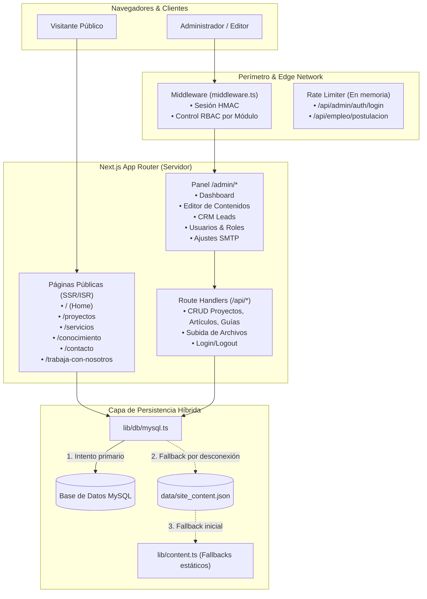

# 01. Arquitectura General y Stack Tecnológico

## 1. Stack Tecnológico

El proyecto está construido sobre el ecosistema moderno de React y Next.js con tipado estático estricto:

| Componente | Tecnología | Versión / Detalle |
| :--- | :--- | :--- |
| **Framework Web** | [Next.js](https://nextjs.org/) | `^15.1.6` (App Router) |
| **Biblioteca UI** | [React](https://react.dev/) | `^19.0.0` |
| **Lenguaje** | [TypeScript](https://www.typescriptlang.org/) | `^5.0.0` (Modo estricto) |
| **Estilos** | [Tailwind CSS](https://tailwindcss.com/) | `^3.4.1` con `@tailwindcss/typography` |
| **Base de Datos** | [MySQL](https://www.mysql.com/) | Conector `mysql2` con pooling de conexiones |
| **Autenticación** | `jose` | Criptografía HMAC-SHA256 para JWTs seguros en Edge & Node |
| **Cifrado de Claves** | `bcryptjs` | Hash de contraseñas con salt adaptativo |
| **Mailing / Notificaciones**| `nodemailer` | Conexión SMTP configurable desde el panel de control |
| **Íconos** | `lucide-react` | Conjunto consistente de iconografía vectorial |

---

## 2. Diagrama de Arquitectura del Sistema

---

## 3. Resiliencia de la Capa de Datos (Fallback Híbrido)

Uno de los pilares de diseño del proyecto es la **alta disponibilidad del contenido**:
1. **Conexión Primaria:** El sistema utiliza un pool de conexiones MySQL configurado con un límite de espera (`connectTimeout: 5000ms`).
2. **Respaldo Local JSON:** Si la base de datos MySQL no responde o no está disponible, el sistema consulta de forma transparente el archivo `data/site_content.json`.
3. **Valores por Defecto:** En caso de que no exista contenido previo en la base de datos o en el archivo local, la aplicación carga los datos base definidos en `lib/content.ts`.

Esto garantiza que el sitio web público **nunca experimente caídas de tipo HTTP 500** por interrupciones puntuales en la base de datos remota.
